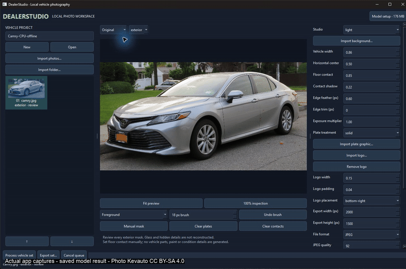
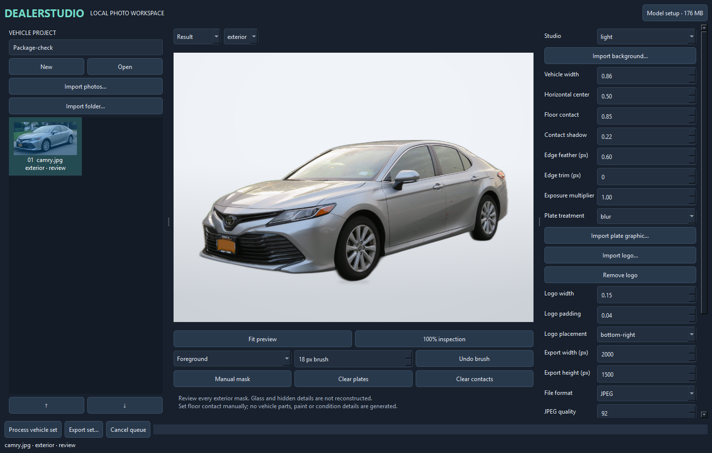
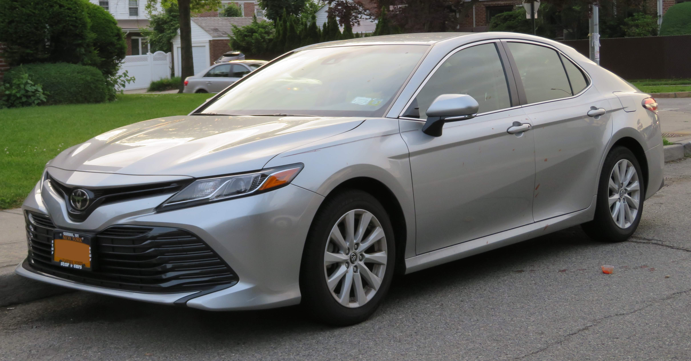
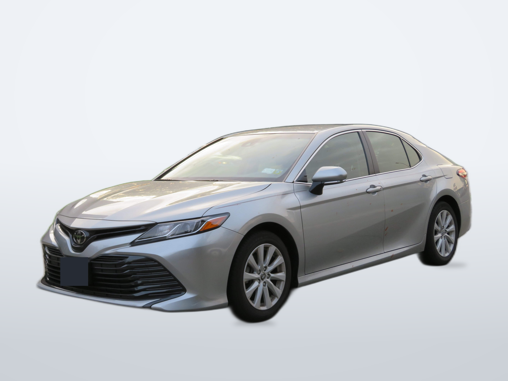

# DealerStudio

Turn your vehicle photos into a consistent dealership listing set on your own computer.



<sub>Actual application captures of a saved local-model result. Photo: Kevauto, CC BY-SA 4.0. [Recording details](media/DEMO.md).</sub>

[](https://github.com/DylanMartinLSC/DealerStudio/releases/latest/download/DealerStudio-windows.zip)

Windows builds are unsigned: if SmartScreen appears, choose **More info → Run anyway**.


### A showroom for the photos you already have.

Turn a folder of vehicle photos into a consistent dealership listing set. Choose a studio, refine the cutout, place your branding, and export the whole vehicle in order—all on your own computer.

**Windows desktop · Local CPU processing · No accounts · No subscriptions · Apache-2.0 code**



*An actual application screenshot, not a mockup. Photograph by Kevauto, CC BY-SA 4.0; [source and attribution](verification/PROVENANCE.md).*

> **Alpha: review every exterior before publishing.** The local model can miss mirrors and thin parts or retain nearby vehicles. In our small benchmark, **3 of 5 new exterior photos required mask correction**. The app includes tools to make those corrections; unattended exports are not ready. [See the failures and results →](benchmark/BENCHMARK_REPORT.md)

## From parking lot to listing

<table>
  <tr><th>Original photo</th><th>Studio composition</th></tr>
  <tr>
    <td></td>
    <td></td>
  </tr>
</table>

*The example uses local segmentation, a neutral bundled background, a small mask correction, a manual plate rectangle and tire-contact adjustments. Vehicle paint, reflections, badges and visible condition come from the source photograph. Original by Kevauto; this derivative is CC BY-SA 4.0. [Full attribution](docs/images/ATTRIBUTION.md).*

DealerStudio changes the presentation of an existing photograph. It does not generate a different vehicle, repair dents, erase scratches, invent hidden parts or reconstruct scenery through windows. Ordinary resizing and optional brightness adjustments still affect exported pixels.

## One vehicle. One consistent set.

1. **Bring in the photos.** Drop files or a folder into a vehicle project. Name it by vehicle or stock number, reorder the shots, and mark exterior, interior or detail.
2. **Choose the presentation.** Pick a light, dark or branded studio—or import your own. Set framing, floor contact, export dimensions and logo placement.
3. **Process and inspect.** A single background worker keeps the queue bounded. Compare originals and results, inspect at full resolution, and correct foreground/background masks with a brush.
4. **Export the set.** Get ordered filenames, consistent dimensions and a report of any failures. Originals can be copied separately. Source files and earlier exports are never overwritten.

Close a job and come back later: project settings, source copies, masks and imported assets stay together in an editable folder.

| Tool | What it does today |
|---|---|
| Local cutouts | U²-Net through ONNX Runtime; CPU works without a GPU |
| Studios | Three original bundled backgrounds plus custom-image import |
| Mask correction | Foreground/background brushes, four brush undos, feathering and edge trim |
| Grounding | Manual scale, center, floor contact, restrained shadow and tire-contact points |
| Branding | Imported logo with adjustable size, padding and corner placement |
| Plates | Manually drawn rectangles with blur, solid fill or a dealer graphic |
| Interior and detail shots | Basic brightness and fit/padding; no exterior background removal |
| Batch consistency | Copy settings to selected photos; save reusable JSON settings presets |
| Export | Custom dimensions, JPEG quality or PNG, ordered names and separate originals |
| Queue | One worker, cancellation between operations, per-photo errors and saved progress |

## Get it running

### Windows source install

Install [Git](https://git-scm.com/) and [uv](https://docs.astral.sh/uv/getting-started/installation/), then open PowerShell:

```powershell
git clone https://github.com/DylanMartinLSC/DealerStudio.git
cd DealerStudio
uv sync --frozen
uv run python launch.py
```

The project uses **Python 3.13**; uv can install the required interpreter if one is missing. Alternatively, run `setup.ps1` followed by `launch.ps1`.

On first launch, click **Model setup · 176 MB**. This explicitly downloads the selected ONNX weights and verifies their SHA-256. The cache is `%USERPROFILE%\.dealerstudio\models\u2net.onnx`; set `DEALERSTUDIO_MODELS` to use a different directory.

**After setup, image processing works offline.** No cloud inference, API keys, account login or telemetry is part of the app. A missing or corrupt model produces a setup error; processing never silently downloads weights or falls back to a cloud service. Keep the verified model cache with a disconnected installation.

### Build a portable Windows app

```powershell
.\package.ps1
```

Run `dist\DealerStudio\DealerStudio.exe`. Keep the whole portable folder together, including `_internal`. Builds are unsigned; this repository does not currently provide an installer or automatic updater. Model setup remains separate from the application package.

For Linux/WSL headless prerequisites and the limits of Linux validation, see the [user guide](USER_GUIDE.md#development-and-packaging) and [clean-install report](verification/wsl/REPORT.md).

## Tested with real photos—including the awkward ones

The repository includes a small, separately licensed [benchmark dataset](benchmark/README.md): sedan front/rear, a pickup, an SUV with roof rails, a side-on hatchback, a convertible, an interior and a derived wheel detail.

The labels were drawn from originals, then frozen before evaluating the five new exterior images. They include six coarse silhouettes and 192 named foreground/background probes. They are approximate, single-annotator references—not dense matting ground truth or a certification.

| What we checked | Result |
|---|---|
| Windows and fresh Ubuntu WSL2 tests | **21 passing on each** at the recorded verification |
| Real CPU segmentation | All six exterior photos processed |
| Windows/Linux consistency | Six full-resolution masks matched pixel-for-pixel |
| Offline operation | Full Linux benchmark ran with no external network interfaces |
| Batch exports | All eight photos exported at 2000 × 1500; originals preserved |
| Automatic mask quality | **3 of 5 new exterior photos crossed review thresholds** |

The pickup lost its extended mirror and roof fin. The rear sedan retained part of another vehicle. The SUV filled a roof-rail opening. These failures remain in the report. High coarse silhouette scores did not make those photos listing-ready.

[Read the benchmark findings](benchmark/BENCHMARK_REPORT.md) · [Inspect the frozen annotation sheet](benchmark/reference-review.jpg) · [Review installation evidence](verification/wsl/REPORT.md)

To run the actual model benchmark locally after model setup:

```powershell
uv run python -m benchmark.run --output benchmark/results/my-run
```

Add `--enforce` to exit with status 2 when any evaluation photo crosses a review threshold. Every run writes metrics, comparisons, an editable project and a complete export set. Scores do not replace visual inspection.

## Where the limits are

- **Thin parts and gaps need attention.** Antennas, mirrors, racks, spoilers and difficult backgrounds can defeat this general saliency model.
- **Glass and reflections stay photographic.** Original window scenery and paint reflections remain; there is no relighting or unseen-detail recovery.
- **Floor contact is approximate.** Use the manual controls. There is no calibrated perspective or realistic reflection synthesis.
- **Color work is restrained.** Brightness is adjustable; there is no automatic paint-color change. Use sRGB inputs because ICC profiles are not color-managed.
- **Large images use memory.** CPU processing is supported; 8 GB RAM or more is recommended. Input limit: 80 MP; export limit: 40 MP. Full-resolution previews and mask undo can pause on large files.
- **Some workflows are still future work.** No automatic classification or plate detection, HEIC/RAW import, searchable multi-project library, advanced matting or signed installer. Optional CUDA selection/fallback exists, but GPU execution is unverified. WSL testing validates the Linux source path; it does not establish a clean Windows EXE installation.

The near-term priorities are better fine-part masks, broader dense annotations, smoother large-image editing, and clean Windows packaging validation.

## Build on it

The processing path is separated into small modules:

```text
studio/app.py       Native Qt UI and serial worker queue
studio/project.py   Project storage, import and source copies
studio/model.py     Explicit model setup and local inference
studio/pipeline.py  Mask edits, compositing, branding and export
benchmark/          Licensed data, frozen annotations and actual model evaluation
```

```powershell
uv run pytest -q
uv run ruff check .
uv run ruff format --check .
```

GitHub CI checks Windows and Linux. The Windows job also builds the portable app and runs a real CPU smoke test after explicit model setup; unit tests themselves do not pretend to establish model quality. See [CONTRIBUTING.md](CONTRIBUTING.md) for the development boundaries.

## Licenses and credits

Original application code and the three original studio backgrounds use **Apache-2.0**. Qt/PySide is dynamically linked under LGPL terms. The selected model weights, dependency code and benchmark photographs have their own licenses; downloadable weights were not treated as unrestricted by default.

Photographic benchmark data and derived example images are **separate from the application's Apache license**. Retain their credits and share-alike terms when redistributing them. The benchmark is excluded from the portable app.

[Application license](LICENSE) · [License inventory](LICENSE_INVENTORY.md) · [Third-party notices](THIRD_PARTY_NOTICES.md) · [Photo credits](benchmark/ATTRIBUTION.md) · [Full user guide](USER_GUIDE.md) · [Verification record](VERIFICATION.md)
